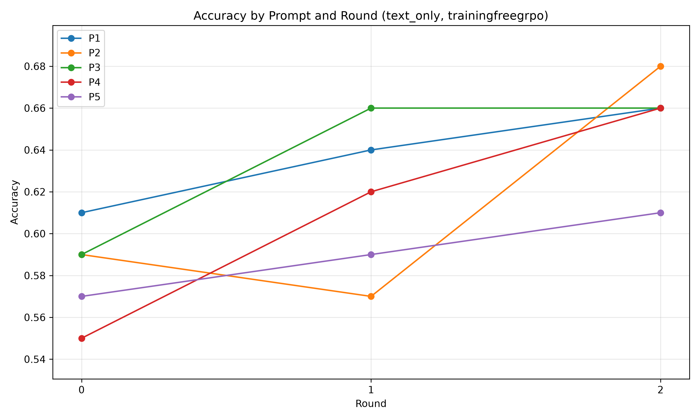

# MathVerse · 피드백 기반 프롬프트 개선 실험

MathVerse 수학 문항에서 **입력 유형과 CoT 프롬프트에 따른 정답·출력 형식·응답 누락을 분석**하고, 정오답 피드백으로 프롬프트를 갱신하는 실험입니다. 문항 ID, 라운드별 응답, 개선된 프롬프트와 평가표를 함께 저장합니다.

코드의 `trainingfreegrpo`는 Training-Free GRPO에서 착안한 프롬프트 개선 흐름을 가리킵니다. 이 구현에서 갱신하는 대상은 **프롬프트 텍스트**이며 모델 가중치를 학습하는 GRPO는 아닙니다.

## 결과에서 코드까지

| 확인할 자료 | 링크 |
|---|---|
| 평가 문항 ID | [sampled_id.json](mathverse100/sampled_id.json) |
| Text Only 결과표 | [정확도 CSV](evaluation_results/text_only/accuracy_by_prompt_all_rounds.csv) |
| P1 초기 응답과 최종 응답 | [Round 0](outputs/text_only/p1/trainingfreegrpo/output_gpt_multichoice_round_0.csv) · [Round 2](outputs/text_only/p1/trainingfreegrpo/output_gpt_multichoice_round_2.csv) |
| 라운드별 프롬프트 | [prompts.json](outputs/text_only/p1/trainingfreegrpo/prompts.json) |
| 생성·피드백·프롬프트 갱신 | [Text Only 실행 코드](main_gpt55_to_trainingfreegrpo.py) |
| 평가·누락 분석 | [정확도 계산](evaluate_prompt_accuracy.py) · [누락 검사](check_missing_model_output.py) |

## 실험 구성

1. `AI4Math/MathVerse`에서 저장된 problem ID에 해당하는 입력을 선택합니다.
2. 문제의 정보 추출, 풀이, 최종 답변 형식을 요구하는 초기 프롬프트를 적용합니다.
3. 정답 여부와 응답을 수집해 개선용 예시를 구성합니다.
4. optimizer LLM에 피드백을 전달해 프롬프트를 갱신합니다.
5. Round 0, 1, 2의 응답과 지표를 비교합니다.

| 입력 유형 | 실행 코드 | 공개된 프롬프트 범위 |
|---|---|---|
| Text Only | [main_gpt55_to_trainingfreegrpo.py](main_gpt55_to_trainingfreegrpo.py) | P1–P5 |
| Text Lite | [main_gpt55_tl_trainingfreegrpo.py](main_gpt55_tl_trainingfreegrpo.py) | P1 |
| Vision Dominant | [main_gpt55_vd_trainingfreegrpo.py](main_gpt55_vd_trainingfreegrpo.py) | P1 |
| Vision Only | [main_gpt55_vo_trainingfreegrpo.py](main_gpt55_vo_trainingfreegrpo.py) | P1 |

공개된 응답 CSV는 8개 조건 × 3개 라운드, 총 24개이며 각 100행입니다. 5프롬프트 × 4입력 유형의 모든 조합을 실행한 결과는 아닙니다.

## 저장된 결과 · P1

| 조건 | 전체 정확도 R0 → R2 | 누락 응답 수 R0 → R2 | 응답 기준 정확도 R0 → R2 |
|---|---:|---:|---:|
| Text Only | 61% → 66% | 29 → 25 | 85.92% → 88.00% |
| Text Lite | 75% → 85% | 24 → 14 | 98.68% → 98.84% |
| Vision Dominant | 73% → 76% | 22 → 19 | 93.59% → 93.83% |
| Vision Only | 69% → 76% | 27 → 21 | 94.52% → 96.20% |

출처: [Text Only](evaluation_results/text_only/accuracy_by_prompt_all_rounds.csv), [Text Lite](evaluation_results/text_lite/accuracy_by_prompt_all_rounds.csv), [Vision Dominant](evaluation_results/vision_dominant/accuracy_by_prompt_all_rounds.csv), [Vision Only](evaluation_results/vision_only/accuracy_by_prompt_all_rounds.csv).

**같은 문항 집합의 정답·결과를 프롬프트 개선에 사용한 뒤 다시 평가한 기록입니다.** 위 차이는 동일 집합 내 개선 과정의 관측치이며, 독립 테스트나 새 문항에 대한 일반화 향상으로 해석하지 않습니다. 정확도 증가와 함께 누락 응답 감소도 확인해야 합니다.



## 지표 정의

| 지표 | 현재 평가 코드의 계산 |
|---|---|
| 전체 정확도 `Accuracy` | `Correct / Total` |
| 누락 응답 | `model_output`이 NaN·빈 문자열·공백·문자열 `nan/none/null`인 행 |
| 응답률 | `(Total − 누락 응답 수) / Total` |
| 응답 기준 정확도 `Answered Accuracy` | `Correct / (Total − 누락 응답 수)` |
| 오답 `Wrong` | `Total − Correct`. 누락 응답도 포함하므로 누락 수와 더하면 중복 계산됨 |

정답 여부는 CSV의 `is_correct`를 우선 사용합니다. 응답이 존재해도 정답 형식이 올바르다는 뜻은 아니며, 형식 준수는 `format_valid`와 함께 확인해야 합니다. 빈 응답의 원인을 모두 모델 추론 실패로 단정하지 않습니다.

## API 없이 저장 결과 재집계

Python 환경에서 아래 패키지를 설치한 뒤 저장소 루트에서 실행합니다. 버전 고정 환경은 아직 제공하지 않습니다.

```bash
python -m pip install pandas matplotlib
python check_missing_model_output.py
python evaluate_prompt_accuracy.py
```

현재 평가 스크립트 기본값은 `DATASET_NAME = "vision_only"`, `PROMPT_IDS = ["p1"]`입니다. Text Only를 계산하려면 파일 상단을 아래처럼 바꿉니다.

```python
DATASET_NAME = "text_only"
PROMPT_IDS = ["p1", "p2", "p3", "p4", "p5"]
```

평가 명령은 기존 요약 CSV·차트를 다시 씁니다. Text Only 요약 CSV 마지막에는 지표가 아닌 단독 `0` 행이 있어, 수동 가공 시 제외하거나 원본 응답에서 재생성해야 합니다.

## LLM 실험 재실행

추가 의존성은 `torch`, `datasets`, `openai`, `Pillow`입니다. `OPENAI_API_KEY`를 실행 환경에 설정해야 하며, 코드가 지정하는 데이터셋 접근과 모델 사용 권한이 필요합니다. 모델 ID 기본값은 코드상 `gpt-5.5`로, 재실행 시 사용 가능한 모델을 직접 지정합니다. 모델을 바꾸면 과거 결과와 동일 조건이 아닙니다.

```bash
python -m pip install torch datasets openai Pillow pandas matplotlib
python main_gpt55_to_trainingfreegrpo.py --model YOUR_AVAILABLE_MODEL_ID --optimizer_model YOUR_OPTIMIZER_MODEL_ID --prompt_name p1 --sampled_id_path mathverse100/sampled_id.json --num_optimization_steps 2 --output_dir outputs/new_text_only_run
```

`YOUR_...` 두 값은 실제 사용 가능한 모델 ID로 교체합니다. API 비용이 발생하며, 위 출력 경로는 기존 결과 덮어쓰기를 피하기 위한 새 경로입니다. 해당 경로를 재집계하려면 평가 스크립트의 탐색 경로도 맞춰야 합니다. 데이터셋 로딩이 인자 처리 전 일부 수행되므로 `--help`도 데이터 접근을 시도할 수 있습니다.

## 해석 범위와 다음 검증

- 개선용 문항과 최종 평가용 문항을 problem ID 단위로 분리해야 일반화 효과를 평가할 수 있습니다.
- 같은 원문 문항의 modality 변형은 같은 분할에 묶어야 합니다.
- [민감도 코드](evaluate_prompt_sensitivity_by_round_prompt.py)는 같은 prompt ID의 **라운드 간 정답 변화**를 계산합니다. 서로 다른 초기 프롬프트 사이의 민감도와 구분합니다.
- 논문 알고리즘과의 세부 일치 범위를 별도 검증하기 전에는 원논문 완전 재현으로 표현하지 않습니다.
- 모델 간 5,000문항 평가는 [별도 저장소](https://github.com/yoon-jr/llm_math_reasoning_eval)에 있습니다.

---
문서 기준: 2026-11-22 · [검토한 코드 버전](https://github.com/yoon-jr/llm_math_reasoning_grpo/tree/7b20691df429ad3445f638738afb31458b6ea0bf). 수치는 저장된 실험 결과이며, 새 실행에서는 환경과 설정에 따라 달라질 수 있습니다.
